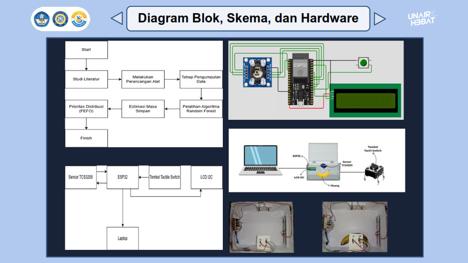
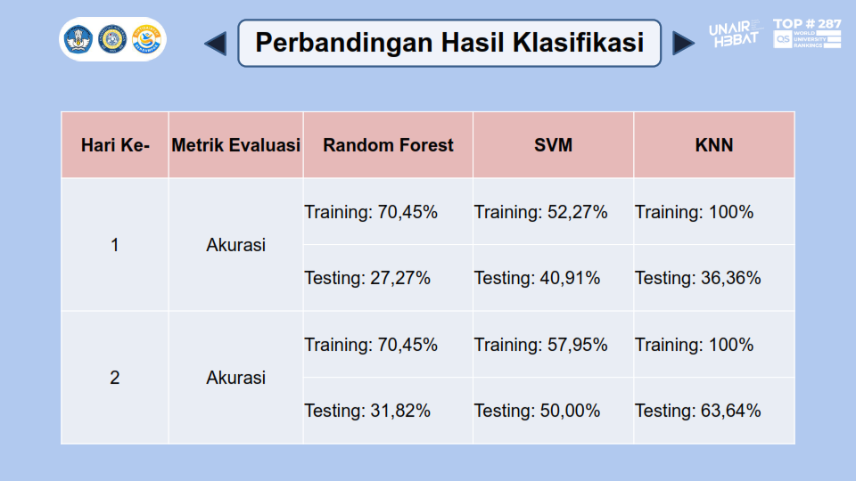
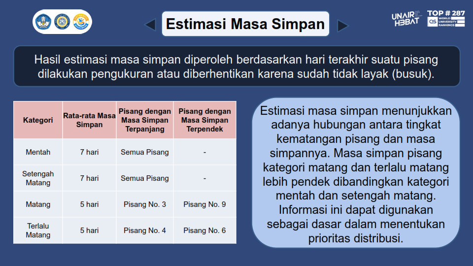
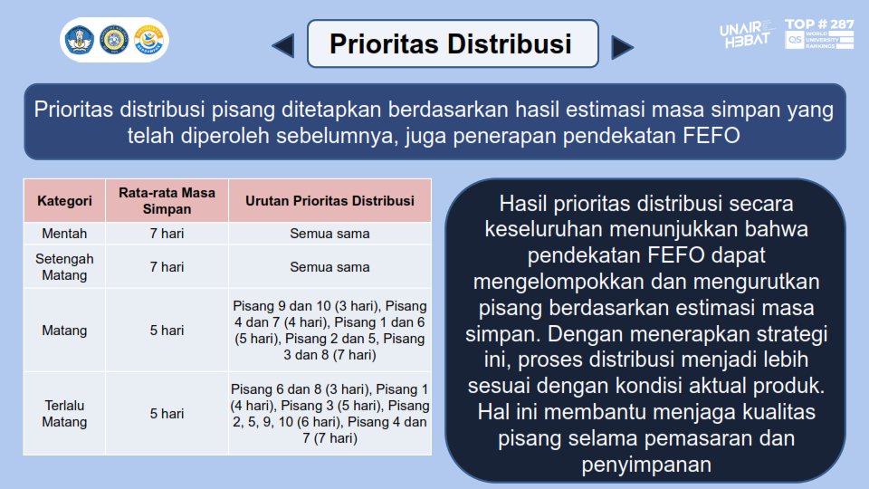

# Skripsi
## Sistem Deteksi Kematangan Pisang, Estimasi Masa Simpan, dan Prioritas Distribusi

Proyek penelitian yang mengintegrasikan sensor warna dan analisis data untuk mengidentifikasi tingkat kematangan pisang Cavendish, memperkirakan masa simpan berdasarkan data pengamatan, serta menentukan prioritas distribusi menggunakan metode FEFO (First Expired, First Out).

Sistem menggunakan ESP32 dan sensor warna TCS3200 untuk memperoleh data frekuensi warna RGB (fR, fG, fB). Data tersebut dianalisis untuk mengidentifikasi karakteristik warna pada empat kategori kematangan, yaitu mentah, setengah matang, matang, dan terlalu matang. Algoritma Random Forest, Support Vector Machine (SVM), dan K-Nearest Neighbors (KNN) digunakan dan dievaluasi untuk klasifikasi tingkat kematangan.

Selain klasifikasi, data pengamatan masa simpan diolah untuk memperoleh estimasi masa simpan berdasarkan kategori kematangan dan menentukan urutan prioritas distribusi. Hasil proyek ini menghubungkan pengukuran sensor, pengolahan data, evaluasi model, dan penerapan prinsip FEFO untuk mendukung pengelolaan distribusi produk pangan.

#### Tujuan
Merancang dan mengembangkan sistem deteksi kematangan pisang non real-time menggunakan sensor warna dan metode Random Forest untuk mengklasifikasikan tingkat kematangan serta mengestimasi masa simpan dan menentukan prioritas distribusi (first-expired-first-out).

#### Tools dan Teknologi
|Tools|Keterangan|
|---|---|
|**Python** |Pengolahan data, analisis, pemodelan, dan evaluasi.|
|**Pandas** |Pengelolaan dan pengolahan dataset.|
|**Scikit-learn** |Implementasi dan evaluasi algoritma machine learning.|
|**ESP32** |Mikrokontroler untuk sistem pengukuran.|
|**TCS3200** |Sensor untuk memperoleh data frekuensi warna.|
|**Arduino IDE** |Pemrograman ESP32 dan pembacaan sensor.|
|**CSV** |Penyimpanan dataset dan hasil pengolahan data.|

#### Metodologi
1. Pengumpulan Data  
Pengukuran dilakukan pada pisang Cavendish menggunakan sensor warna TCS3200 yang terhubung dengan ESP32. Data yang dikumpulkan berupa frekuensi warna merah, hijau, dan biru (fR, fG, fB), serta informasi pendukung seperti identitas sampel, hari pengamatan, titik pengukuran, dan label kematangan.
2. Pengolahan dan Analisis Data  
Data hasil pengukuran disusun menjadi dataset untuk dianalisis berdasarkan kategori kematangan. Analisis dilakukan untuk mempelajari karakteristik dan perbedaan frekuensi warna pada setiap kategori serta menilai kemampuan sensor dalam mendeteksi perubahan kematangan.
3. Klasifikasi dengan Machine Learning  
Tiga algoritma digunakan untuk klasifikasi tingkat kematangan, yaitu:  
a. *Random Forest (RF)*  
b. *Support Vector Machine (SVM)*  
c. *K-Nearest Neighbors (KNN)*  
Model dievaluasi menggunakan data pengukuran untuk membandingkan kinerja klasifikasi. Kategori kematangan yang digunakan terdiri atas mentah, setengah matang, matang, dan terlalu matang.
4. Estimasi Masa Simpan  
Data pengamatan masa simpan diolah berdasarkan kategori kematangan dan identitas sampel pisang. Estimasi masa simpan diperoleh dari durasi pengamatan yang tersedia dalam dataset. Tahap ini merupakan pengolahan data masa simpan tersendiri, bukan prediksi regresi yang dihasilkan oleh model klasifikasi Random Forest.
5. Penentuan Prioritas Distribusi  
Hasil estimasi masa simpan digunakan untuk mengurutkan prioritas distribusi berdasarkan prinsip FEFO (*First Expired, First Out*). Pisang dengan estimasi masa simpan lebih pendek diprioritaskan untuk didistribusikan lebih dahulu.

#### Hasil 
Proyek ini menghasilkan beberapa output:
1. Sistem pengukuran warna pisang berbasis ESP32 dan TCS3200.
2. Dataset frekuensi warna RGB untuk analisis kematangan.
3. Hasil analisis karakteristik warna berdasarkan kategori kematangan.
4. Perbandingan kinerja algoritma RF, SVM, dan KNN.
5. Data estimasi masa simpan berdasarkan hasil pengamatan.
6. Pengurutan prioritas distribusi berdasarkan prinsip FEFO.

#### Catatan 1
Kinerja klasifikasi dipengaruhi oleh kemiripan karakteristik warna antarkategori, terutama antara pisang setengah matang dan matang. Temuan ini menjadi bagian dari evaluasi keterbatasan sistem dan interpretasi hasil penelitian.

#### Catatan 2
Estimasi masa simpan didasarkan pada data pengamatan yang tersedia. Hasilnya tidak dapat dianggap sebagai jaminan masa simpan aktual untuk seluruh kondisi penyimpanan. Perubahan suhu, kelembapan, penanganan, dan kondisi lingkungan dapat memengaruhi proses pematangan pisang.

#### Preview Hasil

